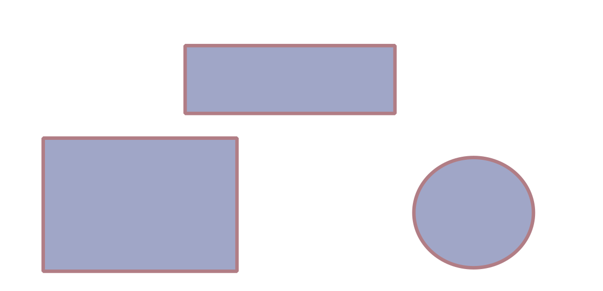

## Introduction & Motivation

- **Current Challenge**: Static PDF slides limit data exploration.
- **Proposed Solution**: Interactive web-based slides via Reveal.js.

$$E = mc^2$$

## My slide

{.frame}


## Methodology (LaTeX & Code)

- We evaluate the differential equation: 

\begin{equation}
    \frac{dy}{dt} = r \cdot y \left(1 - \frac{y}{K}\right)
\end{equation}

``` python
# Example snippet embedded in slide
import numpy as np
y = np.linspace(0, 10, 100)
```

## Results & Progressive Disclosure

::: incremental
- First key finding appears.
- Second quantitative metric revealed.
- Final conclusion drawn.
:::

## {.thanks-slide data-state="is-thanks-slide"}

[Thank you for your attention]{.thanks-text}

[Questions?]{.thanks-questions}


## Acknowledgments

:::: {.columns}

::: {.column width="50%"}
### Lab members

- Name Surname
- Name Surname
- Name Surname
:::

::: {.column width="50%"}
### Funding

::: {.funding-logos}


:::
:::

::::
