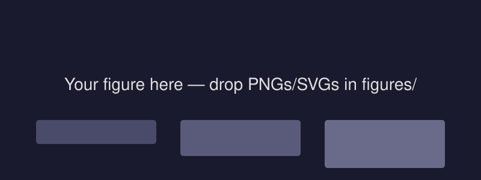

# Why this repo

Markdown you already write → **reveal.js slides**, rendered by **GitHub Actions**, viewed in Safari on the iPad.

## The workflow

1. Draft ideas in a daily note (`2026-10-15.md`) in *private-notes*
2. Lift the relevant sections into a `.qmd` file here
3. Run the `sync` alias on the iPad
4. GitHub Actions renders → **GitHub Pages** shows the deck

---

# Markdown you already use works as-is

## Checklists, highlights, links

- [x] Create the `presentations` repo
- [ ] Draft the **Visual-Stimulation for Decoding** protocol deck
- [ ] GluN3 figures: add `==percentage responsive==`

::: {.notes}
Speaker notes go in a `::: {.notes}` block — press `S` while presenting to see them.
:::

---

# Two-column layouts

::: columns

::: column
### Notes side

- Obsidian-friendly markdown
- relative links to `../Literature/...`
- git is the sync layer
:::

::: column
### Code side

```python
# from lab-notebook: templates/python_script.py
data = get(args)
plot(data)
plt.show()
```

:::

:::

---

# Figures

Put figures in the `figures/` folder of this repo:



## Then cite the analysis script

> `_archives/2026/10-October/15-Wednesday-...-anr-Toy-Ntwk.py` (Lab-notebook)

---

# Fragments & incremental build

- Bullets can appear one by one
- just add `::: {.fragment}` blocks

::: {.fragment}
- like this
:::

::: {.fragment}
- and this
:::

---

# That's it

## Next steps

- Copy `demo-presentation.qmd` → rename for a new deck
- Everything renders automatically on push
- Point Safari at the Pages URL, "Add to Home Screen" for quick access
